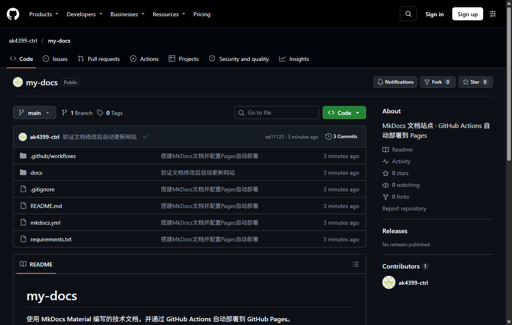
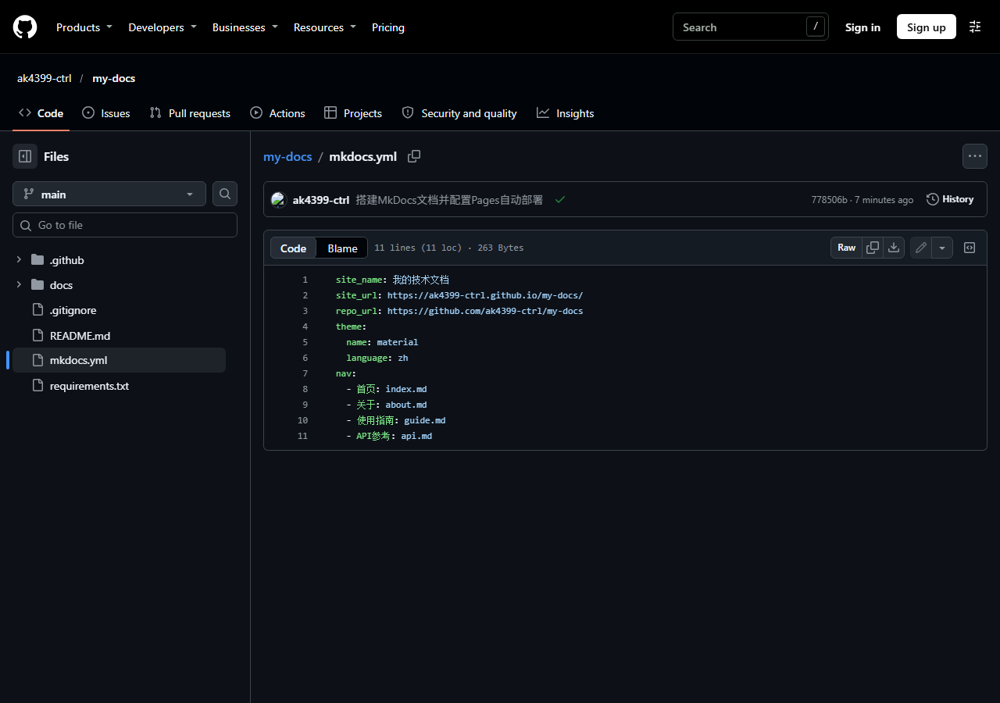
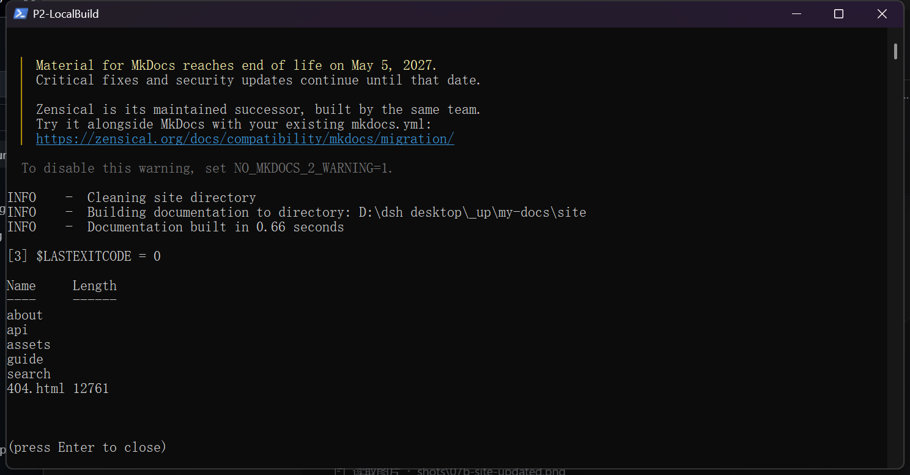
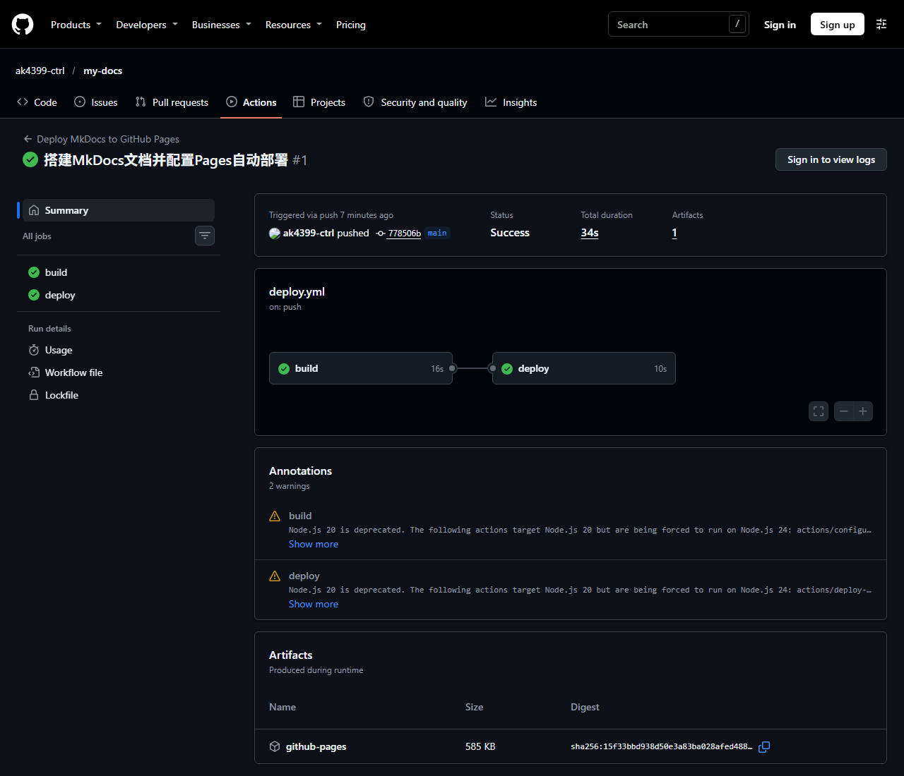
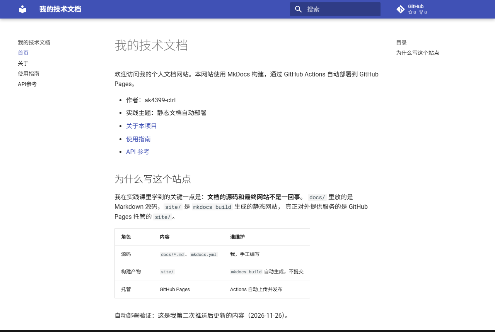
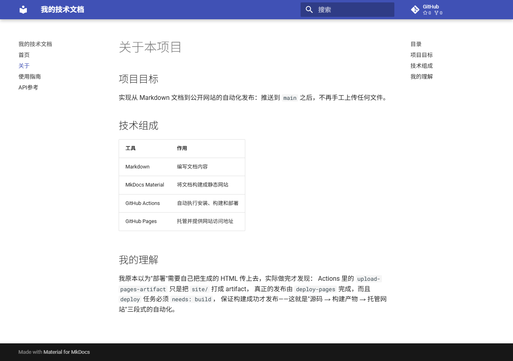
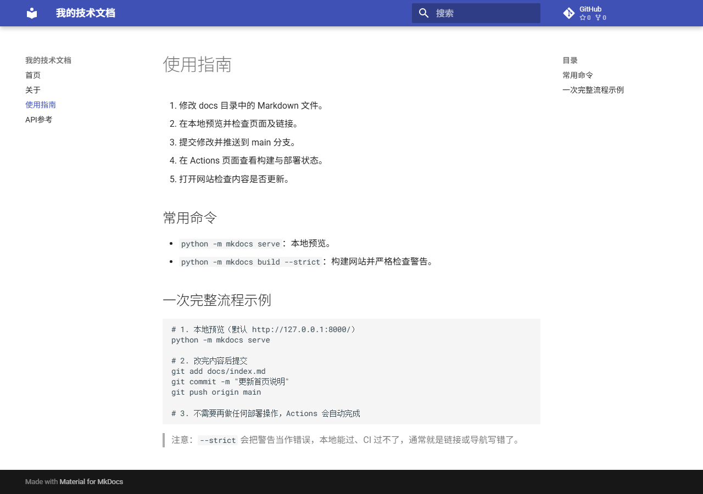
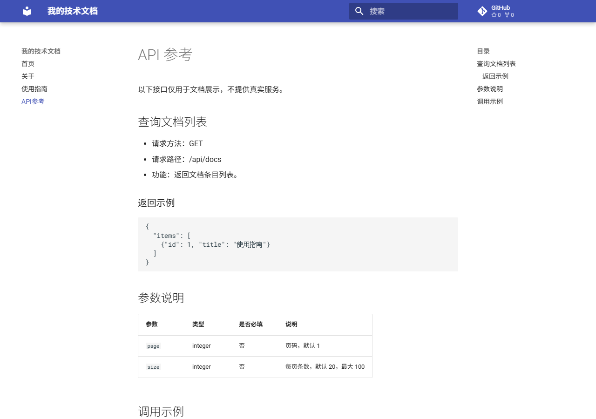
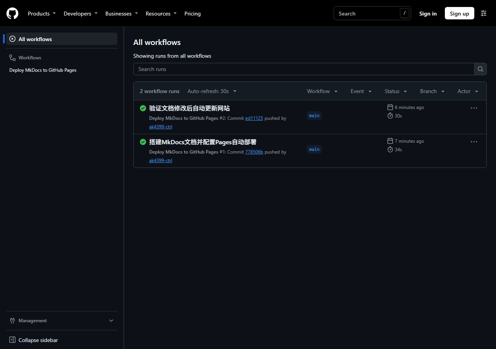
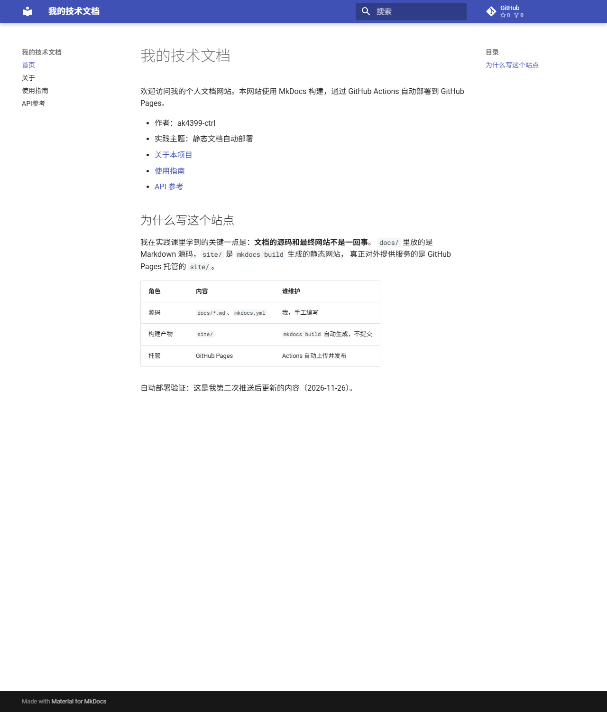

# 实践项目2：个人实验报告

## 1. 基本信息

- GitHub 登录名：ak4399-ctrl
- 个人仓库地址：<https://github.com/ak4399-ctrl/my-docs>
- 最终网站地址：<https://ak4399-ctrl.github.io/my-docs/>
- 首次部署运行：<https://github.com/ak4399-ctrl/my-docs/actions/runs/45794209889>（提交 `778506b`）
- 第二次（自动更新）运行：<https://github.com/ak4399-ctrl/my-docs/actions/runs/45794336261>（提交 `ed11125`）

---

## 2. 实践过程与关键截图

### 2.1 仓库创建

登录 GitHub 后新建 **Public** 仓库 `my-docs`（默认分支 `main`），本地 `git clone` 后在其中建立目录结构。



可以看到：仓库属于 `ak4399-ctrl`，名字 `my-docs`，右侧有 `Public` 标签，最新提交已是"验证文档修改后自动更新网站"。

### 2.2 项目结构与 MkDocs 配置

```text
my-docs/
├── .github/workflows/deploy.yml   # 推送 main 后自动构建并部署
├── docs/                          # 4 页文档源码
│   ├── index.md  about.md  guide.md  api.md
├── mkdocs.yml                     # 站点名、主题、导航
├── requirements.txt               # mkdocs + mkdocs-material
├── .gitignore                     # 忽略 site/、.venv/、.pylibs/
├── README.md
└── report/                        # 本报告与截图
```



`mkdocs.yml` 里三个关键字段：

- `site_url`：`https://ak4399-ctrl.github.io/my-docs/`，决定生成站点的绝对链接（必须有 `/my-docs/` 这一层，因为这是项目站点）；
- `theme.name: material` + `language: zh`：主题与中文界面；
- `nav`：四个页面的顺序，路径**相对于 `docs/`**，所以写 `index.md` 而不是 `docs/index.md`。

`docs/` 是网站内容源，`site/` 是 `mkdocs build` 的产物（见 2.3），后者不提交。

### 2.3 本地构建或预览

```powershell
python -m mkdocs build --strict
```



- `--strict` 会把警告（断链、导航缺失等）当错误，本地能过说明四页链接和导航是完整的；
- 输出 `Documentation built in 0.66 seconds`、`$LASTEXITCODE = 0`；
- 生成的 `site/` 下有 `about/ api/ assets/ guide/ search/ 404.html ...`，说明四页都产出了；
- 另外用 `python -m mkdocs serve` 在 `http://127.0.0.1:8000/` 逐页看过导航、表格、代码块，确认无误后再推送。

### 2.4 Pages 设置

在仓库 `Settings → Pages → Build and deployment → Source` 选择 **GitHub Actions**（不是 "Deploy from a branch"）。本仓库已通过 GitHub API 确认该设置生效（`build_type: workflow`），部署地址为 `https://ak4399-ctrl.github.io/my-docs/`。

> 说明：设置页需要仓库所有者登录，本次自动化环境下无法截到该页面，已在报告中用 API 返回值说明；如需网页截图可登录后在 `Settings → Pages` 补拍。

### 2.5 Actions 首次构建和部署

推送 `main` 后工作流 `Deploy MkDocs to GitHub Pages` 自动运行：



- 触发方式：`push`（提交 `778506b`），耗时 34 s；
- `build` 16 s、`deploy` 10 s，两个 job 都是绿色对勾；
- 产物 `github-pages` 585 KB，由 `upload-pages-artifact` 上传、`deploy-pages` 发布；
- 两条 warning 是 `actions/configure-pages`、`deploy-pages` 内部运行在 Node 24 上对 Node 20 的兼容提示，不影响结果。

### 2.6 网站访问与四页导航检查

网站地址：<https://ak4399-ctrl.github.io/my-docs/>

| 页面 | 截图 | 检查点 |
| --- | --- | --- |
| 首页 |  | 标题、作者、三处页面链接、表格 |
| 关于 |  | 技术组成表格、我的理解段落 |
| 使用指南 |  | 有序列表、`bash` 代码块 |
| API 参考 |  | JSON 示例、参数表、`curl` 示例 |

四页的左侧导航均能互相跳转，代码块高亮、表格样式正常，没有 404 或样式丢失。

### 2.7 第二次推送与自动更新验证

修改 `docs/index.md`，加入一句容易辨认的文字：

```markdown
自动部署验证：这是我第二次推送后更新的内容（2026-11-26）。
```

推送后**没有点任何手动部署**，`push` 自动触发了新运行：

- 对应提交：<https://github.com/ak4399-ctrl/my-docs/commit/ed11125>
- 对应 Actions 运行：<https://github.com/ak4399-ctrl/my-docs/actions/runs/45794336261>



刷新网站后，首页底部出现新增的那句话，说明"改源码 → 推送 → 自动构建 → 自动部署 → 网页更新"整条链路通了：



---

## 3. 问题与解决

| 现象 | 原因 | 解决 |
| --- | --- | --- |
| 本地 `pip install -r requirements.txt` 报 `Permission denied`（写入临时目录） | 本机沙箱限制，pip 的临时目录不可写 | 改为安装到项目内 `.pylibs`（`--target`）并设置 `PYTHONPATH`，构建时直接 `python -m mkdocs build`；`.pylibs/` 已加入 `.gitignore`，不进仓库 |
| Material 提示 "reaches end of life on May 5, 2027" | 主题的 EOL 提示，不是错误 | 忽略；构建与部署均正常 |
| 担心 `site/` 被提交 | `site/` 是产物 | `.gitignore` 已忽略，`git status` 里看不到 `site/` |
| 首次部署失败风险 | 若 Pages 来源仍是分支模式，`deploy-pages` 无法发布 | 推送前先把 `Settings → Pages → Source` 设为 GitHub Actions |

核对过的日志/配置：`build` job 的 `mkdocs build --strict` 输出、artifact 大小（585 KB）、`deploy` job 的 `page_url`、`Settings → Pages` 的 `build_type`。

---

## 4. 原理理解

**1. `docs/` 和 `site/` 各保存什么？为什么不用手工修改 `site/`？**

`docs/` 是**源码**：我手写的 Markdown 和 `mkdocs.yml`；`site/` 是 `mkdocs build` 生成的**构建产物**（HTML、CSS、JS、搜索索引）。每次构建都会先 `Cleaning site directory` 整体重建，手改的内容会被覆盖；而且产物由 CI 在干净环境里重新生成，本地改的 `site/` 也不会进入部署。所以只改 `docs/`，`site/` 交给构建。

**2. 本次工作流在什么情况下自动运行？**

`on.push.branches: [main]` 且改动命中 `paths`（`docs/**`、`mkdocs.yml`、`requirements.txt`、`.github/workflows/deploy.yml`）时；此外 `workflow_dispatch` 允许在 Actions 页面手动运行。

**3. `build` 与 `deploy` 两个任务有什么区别？**

`build` 是"造产物"：checkout 源码 → 安装 Python 3.12 → `pip install` → `mkdocs build --strict` → `upload-pages-artifact` 把 `site/` 打成 artifact。`deploy` 是"发产物"：`needs: build` 保证构建成功才执行，用 `actions/deploy-pages` 把 artifact 发布到 `github-pages` 环境，因此需要 `pages: write` 和 `id-token: write`。

**4. 只修改 `report/README.md` 会触发部署吗？为什么？**

不会。`paths` 只包含 `docs/**`、`mkdocs.yml`、`requirements.txt` 和工作流文件，`report/**` 不在其中；这也是我提交报告时 Actions 不重新运行的原因（预期行为）。

**5. 本次方案为何无需创建 `gh-pages` 分支？**

官方 Pages Actions 走的是"artifact + 部署任务"的模型：`upload-pages-artifact` 上传、`deploy-pages` 直接发布到 Pages 托管，不需要把构建产物提交到任何分支。`gh-pages` 分支是旧的分支发布方式，本次没有使用，所以也不需要给 Actions 开仓库写权限或创建 PR 的权限。
